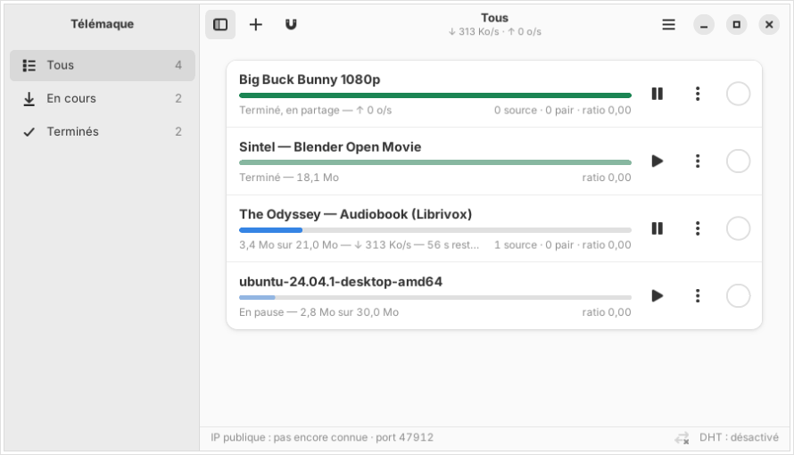

# Télémaque

**A simple BitTorrent client for GNOME — GTK4 / libadwaita, on libtorrent.**
**Un client BitTorrent tout simple pour GNOME — GTK4 / libadwaita, sur libtorrent.**

[English](#english) · [Français](#français)



| Ajouter / Add | Sombre / Dark | Accueil / Welcome |
|---|---|---|
|  |  |  |

---

## English

Télémaque downloads torrents, and only that: no video sites, no RSS, no search engine. It uses
libtorrent, the engine of qBittorrent and Deluge, and follows your desktop theme. Not a Flatpak: a plain
Debian package, like its siblings [Odysseus](https://github.com/ToFpon/Odysseus) (file manager),
[Nausicaa](https://github.com/ToFpon/Nausicaa) (video player) and [Calypso](https://github.com/ToFpon/Calypso)
(PDF viewer).

- **.torrent files and magnet links**: open button, Ctrl+O, Ctrl+V for a magnet link in the clipboard,
  drag and drop, or straight from Firefox and your file manager.
- **Before starting**: choose the folder and the files to keep (uncheck the bonus of a season pack).
  Files can also be checked or unchecked during the download.
- **Sidebar**: All, In Progress, Finished, with their count.
- **The list**: progress, speed, time left; pause, resume, remove (with or without the files);
  open the result or show it in its folder.
- **Several at once**: round check boxes on the right of each line, then pause, resume, move or remove
  the selection (Ctrl+A, Esc, Delete).
- **Rename** the folder or any file, before starting or at any time afterwards (the torrent stays the same for
  the tracker and the other peers; an existing file is never overwritten).
- **Move the files** to another folder, during or after the download (never over an existing file).
- **Sharing**: stops at the ratio you choose (1.0 by default), never stops, or stops right away.
- **Incomplete files end with .part** (like qBittorrent's .!qB): no confusion between a finished file and one
  still downloading or paused; it gets its real name back as soon as it is complete (option, on by default).
- Option: **delete the .torrent file** once added, to leave fewer files lying around.
- **Speed limits**, port, DHT; a desktop notification when a download is finished; the computer does not
  suspend during a download.
- **Closing the window** while something is running: keep running in the background (with an icon in the
  top bar: status, show, pause all, quit), or quit.
  Downloads resume by themselves at the next start.

### Install
Ubuntu 24.04 / 26.04, Zorin OS 18, Linux Mint 22:
```sh
sudo add-apt-repository ppa:nourpon/telemaque
sudo apt update && sudo apt install telemaque
```
To open magnet links and .torrent files with Télémaque: Preferences → General → “Default application for
torrents”.
Other Debian-based distributions: the `.deb` of the [releases](https://github.com/ToFpon/Telemaque/releases),
then `sudo apt install ./telemaque_X_all.deb`. From the source code: `./install.sh` (in `~/.local`).
Site: https://tofmicro.pages-perso.free.fr/Telemaque/

---

## Français

Télémaque télécharge des torrents, et seulement ça : ni sites de vidéos, ni RSS, ni moteur de recherche.
Il s'appuie sur libtorrent, le moteur de qBittorrent et de Deluge, et suit le thème du bureau. Pas de
Flatpak : un simple paquet Debian, comme ses frères [Odysseus](https://github.com/ToFpon/Odysseus)
(gestionnaire de fichiers), [Nausicaa](https://github.com/ToFpon/Nausicaa) (lecteur vidéo) et
[Calypso](https://github.com/ToFpon/Calypso) (visionneuse PDF).

- **Fichiers .torrent et liens magnet** : bouton d'ouverture, Ctrl+O, Ctrl+V pour un lien magnet copié,
  glisser-déposer, ou directement depuis Firefox et le gestionnaire de fichiers.
- **Avant de lancer** : le dossier et les fichiers à garder (décocher les bonus d'un pack de saison). On
  peut aussi cocher ou décocher des fichiers en cours de route.
- **Barre latérale** : Tous, En cours, Terminés, avec leur nombre.
- **La liste** : progression, vitesse, temps restant ; pause, reprise, suppression (avec ou sans les
  fichiers) ; ouvrir le résultat ou l'afficher dans son dossier.
- **Plusieurs à la fois** : cases rondes à droite de chaque ligne, puis pause, reprise, déplacement ou
  suppression de la sélection (Ctrl+A, Échap, Suppr).
- **Renommer** le dossier ou n'importe quel fichier, avant de lancer ou à tout moment ensuite (le torrent reste le
  même pour le tracker et les autres pairs ; un fichier déjà présent n'est jamais écrasé).
- **Déplacer les fichiers** vers un autre dossier, pendant ou après le téléchargement (jamais par-dessus un
  fichier existant).
- **Le partage** : s'arrête au ratio choisi (1,0 par défaut), ne s'arrête jamais, ou s'arrête tout de suite.
- **Fichiers incomplets en .part** (comme le .!qB de qBittorrent) : pas de confusion entre un fichier fini et un
  fichier en cours ou en pause ; il reprend son vrai nom dès qu'il est complet (option, active par défaut).
- En option : **supprimer le fichier .torrent** une fois ajouté, pour laisser moins de fichiers qui traînent.
- **Limites de vitesse**, port, DHT ; une notification du bureau à la fin d'un téléchargement ;
  l'ordinateur ne se met pas en veille pendant un téléchargement.
- **Fermer la fenêtre** pendant que ça tourne : continuer en arrière-plan (avec une icône dans la barre du
  haut : état, afficher, tout mettre en pause, quitter), ou quitter. Les téléchargements
  reprennent tout seuls au lancement suivant.

### Installation
Ubuntu 24.04 / 26.04, Zorin OS 18, Linux Mint 22 :
```sh
sudo add-apt-repository ppa:nourpon/telemaque
sudo apt update && sudo apt install telemaque
```
Pour ouvrir les liens magnet et les fichiers .torrent avec Télémaque : Préférences → Général → « Application
par défaut pour les torrents ».
Autres distributions basées sur Debian : le `.deb` des [releases](https://github.com/ToFpon/Telemaque/releases),
puis `sudo apt install ./telemaque_X_all.deb`. Depuis le code : `./install.sh` (dans `~/.local`).

License: GPL-3.0.
