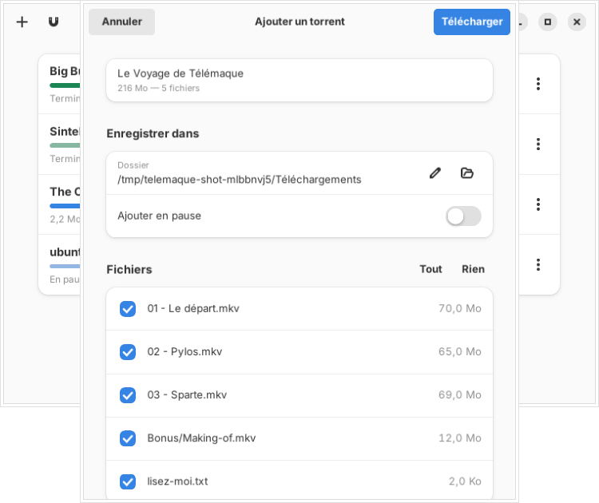
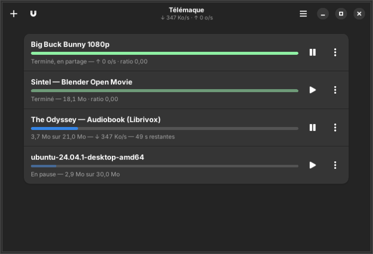
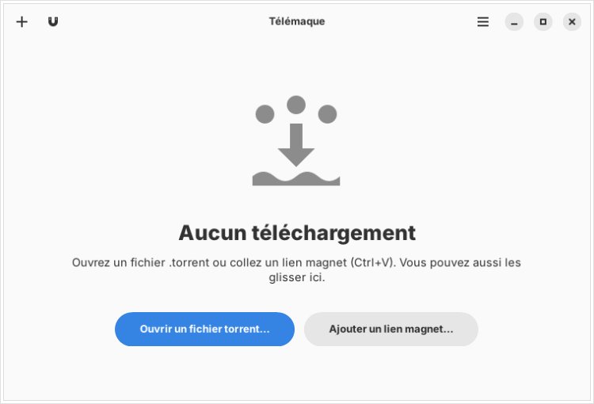

# Télémaque

**A simple BitTorrent client for GNOME — GTK4 / libadwaita, on libtorrent.**
**Un client BitTorrent tout simple pour GNOME — GTK4 / libadwaita, sur libtorrent.**

[English](#english) · [Français](#français)


| Ajouter / Add | Sombre / Dark | Accueil / Welcome |
|---|---|---|
|  |  |  |

---

## English

Télémaque downloads torrents, and only that: no video sites, no RSS, no search engine. It uses
libtorrent, the engine of qBittorrent and Deluge, and follows your desktop theme. Not a Flatpak: a plain
Debian package, like its siblings [Odysseus](https://github.com/ToFpon/Odysseus) (file manager),
[Nausicaa](https://github.com/ToFpon/Nausicaa) (video player) and [Calypso](https://github.com/ToFpon/Calypso)
(PDF viewer).

- **.torrent files and magnet links**: open button, Ctrl+O, Ctrl+V for a magnet link in the clipboard,
  drag and drop, or straight from Firefox and your file manager.
- **Before starting**: choose the folder and the files to keep (uncheck the bonus of a season pack).
  Files can also be checked or unchecked during the download.
- **The list**: progress, speed, time left; pause, resume, remove (with or without the files);
  open the result or show it in its folder.
- **Sharing**: stops at the ratio you choose (1.0 by default), never stops, or stops right away.
- **Speed limits**, port, DHT; a desktop notification when a download is finished; the computer does not
  suspend during a download.
- **Closing the window** while something is running: keep running in the background, or quit.
  Downloads resume by themselves at the next start.

### Install (from the source code, for now)
```sh
sudo apt install python3-libtorrent python3-gi gir1.2-gtk-4.0 gir1.2-adw-1
git clone https://github.com/ToFpon/Telemaque && cd Telemaque && ./install.sh
xdg-mime default io.github.telemaque.Telemaque.desktop x-scheme-handler/magnet application/x-bittorrent
```

---

## Français

Télémaque télécharge des torrents, et seulement ça : ni sites de vidéos, ni RSS, ni moteur de recherche.
Il s'appuie sur libtorrent, le moteur de qBittorrent et de Deluge, et suit le thème du bureau. Pas de
Flatpak : un simple paquet Debian, comme ses frères [Odysseus](https://github.com/ToFpon/Odysseus)
(gestionnaire de fichiers), [Nausicaa](https://github.com/ToFpon/Nausicaa) (lecteur vidéo) et
[Calypso](https://github.com/ToFpon/Calypso) (visionneuse PDF).

- **Fichiers .torrent et liens magnet** : bouton d'ouverture, Ctrl+O, Ctrl+V pour un lien magnet copié,
  glisser-déposer, ou directement depuis Firefox et le gestionnaire de fichiers.
- **Avant de lancer** : le dossier et les fichiers à garder (décocher les bonus d'un pack de saison). On
  peut aussi cocher ou décocher des fichiers en cours de route.
- **La liste** : progression, vitesse, temps restant ; pause, reprise, suppression (avec ou sans les
  fichiers) ; ouvrir le résultat ou l'afficher dans son dossier.
- **Le partage** : s'arrête au ratio choisi (1,0 par défaut), ne s'arrête jamais, ou s'arrête tout de suite.
- **Limites de vitesse**, port, DHT ; une notification du bureau à la fin d'un téléchargement ;
  l'ordinateur ne se met pas en veille pendant un téléchargement.
- **Fermer la fenêtre** pendant que ça tourne : continuer en arrière-plan, ou quitter. Les téléchargements
  reprennent tout seuls au lancement suivant.

### Installation (depuis le code, pour l'instant)
```sh
sudo apt install python3-libtorrent python3-gi gir1.2-gtk-4.0 gir1.2-adw-1
git clone https://github.com/ToFpon/Telemaque && cd Telemaque && ./install.sh
xdg-mime default io.github.telemaque.Telemaque.desktop x-scheme-handler/magnet application/x-bittorrent
```

License: GPL-3.0.
